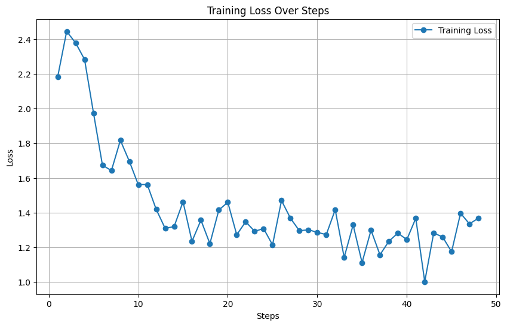
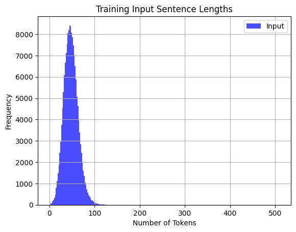
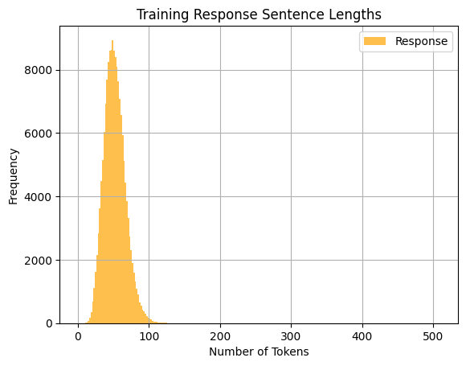

# Llama 3.2 Supportive Dialogue Fine-Tuning with QLoRA

Fine-tuning experiment using **Llama 3.2 3B Instruct**, **Unsloth**, and **4-bit quantization with LoRA adapters** on a public synthetic conversation dataset. The project investigates the data preparation, supervised fine-tuning, and evaluation workflow for supportive dialogue generation.

> **Research and educational demonstration only.** This is not a licensed therapist, mental-health treatment, crisis-response service, or clinically validated system. Synthetic conversations may contain biases and unsafe or unreliable advice. Do not use the model for real-world mental-health decisions.

## Original notebook preserved

The notebook [`notebooks/llama_therapist.ipynb`](notebooks/llama_therapist.ipynb) is an **unchanged copy of the original uploaded notebook**. Its evaluation code, other code cells, execution logs, graphs, saved sample responses, and Google Drive paths are retained exactly as provided. Training and evaluation were **not rerun** for this repository. The notebook's saved results reflect the original run, not independently verified benchmarks.

The training-loss and token-length charts are also available separately in [`assets/`](assets/) for quick review. **To view the model's example responses, open the notebook and scroll to the inference cells near the end.**

The notebook uses the original Google Colab and Google Drive paths. Those paths may need changing if another person wants to rerun it, but they have deliberately been left unchanged in this version.

## Project overview

- **Base model:** [`unsloth/Llama-3.2-3B-Instruct`](https://huggingface.co/unsloth/Llama-3.2-3B-Instruct)
- **Dataset:** [`jerryjalapeno/nart-100k-synthetic`](https://huggingface.co/datasets/jerryjalapeno/nart-100k-synthetic), a synthetic dialogue dataset (99,086 source conversation records listed by Hugging Face)
- **Training approach:** supervised fine-tuning with 4-bit model loading and LoRA adapters using Unsloth and `trl.SFTTrainer`
- **Environment used in the recorded run:** Google Colab, NVIDIA Tesla T4 GPU
- **Primary libraries:** Python, PyTorch, Hugging Face Transformers and Datasets, TRL, Unsloth, Pandas, scikit-learn

## What I implemented

1. Loaded the 3B instruction model in 4-bit mode and configured LoRA adapters on attention and feed-forward projection layers.
2. Sampled 20% of the original conversation records, then extracted alternating user/assistant turns into **161,466 input-response pairs**.
3. Prepared the examples using a Llama chat template and created **160,658 training pairs** and **808 validation pairs**.
4. Configured response-only supervised fine-tuning, recording the loss over **48 training steps**.
5. Experimented with ROUGE, METEOR, BERTScore, and a small set of qualitative response examples.
6. Saved LoRA adapter weights and tokenizer files locally in the Colab workflow. **The trained checkpoint is not included in this repository.**

## Recorded training configuration

| Setting | Value |
| --- | --- |
| Base model | Llama 3.2 3B Instruct |
| Quantization | 4-bit |
| LoRA rank (`r`) | 16 |
| LoRA alpha | 16 |
| Sequence length | 150 tokens |
| Per-device batch size | 2 |
| Gradient accumulation | 4 |
| Effective batch size | 8 |
| Learning rate | 2e-4 |
| Max training steps | 48 |
| Optimizer | `adamw_8bit` |
| Recorded GPU | NVIDIA Tesla T4 |

**Important:** The notebook sets both `num_train_epochs=1` and `max_steps=48`. The 48-step limit stopped the run well before a full epoch over all prepared training examples. It is a short fine-tuning experiment, not evidence of a fully trained or converged system.

## Training loss

The chart below was generated by the original notebook during the 48-step run. It shows training loss only and does not establish quality on unseen conversations.



## Token length distributions

| Input token lengths | Response token lengths |
| --- | --- |
|  |  |

## Evaluation and limitations

The original notebook contains its saved ROUGE, METEOR, and BERTScore experiments and generated response examples. The original evaluation code was not modified. **Those outputs should not be treated as validated performance benchmarks.** The evaluation code has notable limitations:

- It constructs a batch as one conversation instead of separate independent chats.
- It decodes the generated token sequences without removing prompt tokens before comparison to references.
- It separates individual turn pairs into training and validation data, which can place turns from the same original conversation in both splits.
- The final printed dictionary differs from the evaluation function's returned fields, suggesting stale or out-of-order notebook state.
- The dataset is entirely synthetic, is not representative of real clinical interactions, and includes recurrent character names that appeared in sample generations.
- No clinical, safety, crisis-handling, fairness, or expert-based evaluation was conducted.

See [Experiment notes](docs/EXPERIMENT_NOTES.md) for exact observed outputs and a suggested evaluation redesign.

## Repository structure

```text
.
├── notebooks/
│   └── llama_therapist.ipynb      # Original notebook: all code, graphs, logs and responses retained
├── assets/
│   ├── training_loss.png
│   ├── input_token_lengths.png
│   └── response_token_lengths.png
├── docs/
│   └── EXPERIMENT_NOTES.md        # Methodology, issues and next steps
├── requirements.txt              # Reference Python dependencies
├── .gitignore
└── README.md
```

## How to explore

1. Open [`notebooks/llama_therapist.ipynb`](notebooks/llama_therapist.ipynb) directly on GitHub to view the saved graphs and generated responses. You do not need to run the notebook to view these outputs.
2. If you choose to rerun the notebook in Google Colab, a compatible NVIDIA GPU, accessible Google Drive paths, and compatible package versions are needed. No code has been adapted in this repository.
3. The notebook fetches the public dataset from Hugging Face. The repository does not ship the raw conversation dataset or trained model files.
4. Saved evaluation scores appear exactly as originally produced. They are not independently validated. See the experiment notes for limitations. No evaluation logic was edited or rerun.

The notebook is the **unaltered historical experiment**, not a fully tested one-command pipeline. Training and evaluation were not rerun while preparing this repository.

## Responsible use

- Educational machine-learning project only; no claims of clinical validity or therapeutic effectiveness.
- Do not present generated content as treatment, diagnosis, or crisis counselling.
- If expanding this work, first implement safety evaluations, crisis-response safeguards, rigorous data provenance reviews, and expert oversight.
- The linked Hugging Face dataset is labeled **OpenRAIL**. Read the dataset terms and underlying model license before distributing data, adapters, or a hosted service.
- Only plots and source code needed to explain this experiment are included here.

## References

- Suman Das, [Fine Tune Large Language Model (LLM) on a Custom Dataset with QLoRA](https://dassum.medium.com/fine-tune-large-language-model-llm-on-a-custom-dataset-with-qlora-fb60abdeba07) (tutorial).
- Jerry Jalapeno, [nart-100k-synthetic](https://huggingface.co/datasets/jerryjalapeno/nart-100k-synthetic) (synthetic conversational dataset).
- Unsloth, [official GitHub repository](https://github.com/unslothai/unsloth) (fine-tuning library).
- Meta / Unsloth, [Llama 3.2 3B Instruct model card](https://huggingface.co/unsloth/Llama-3.2-3B-Instruct).

## Portfolio focus

This project demonstrates hands-on experience with **LLM fine-tuning workflows, synthetic dialogue preprocessing, PEFT/LoRA, GPU training, quality evaluation, and responsible reporting of experiment limitations**.

## Author

Mohamed Hassanien
